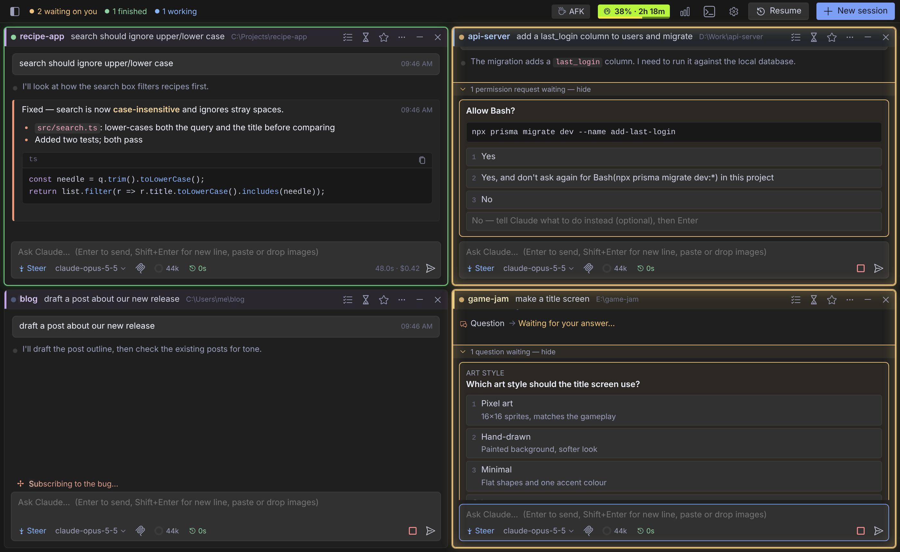
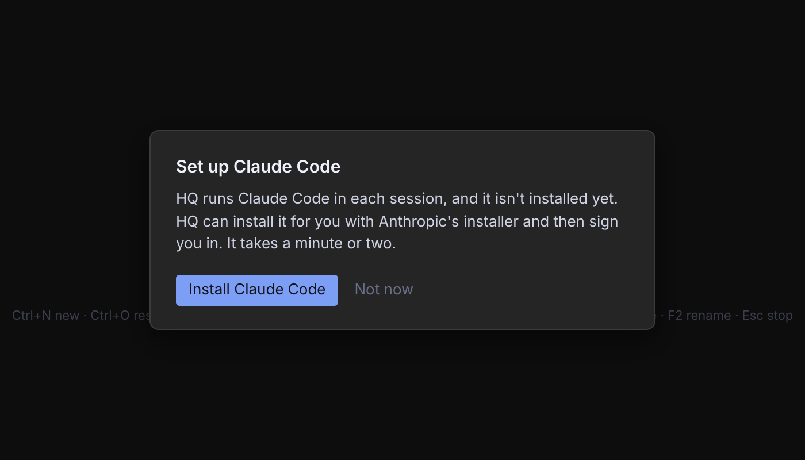
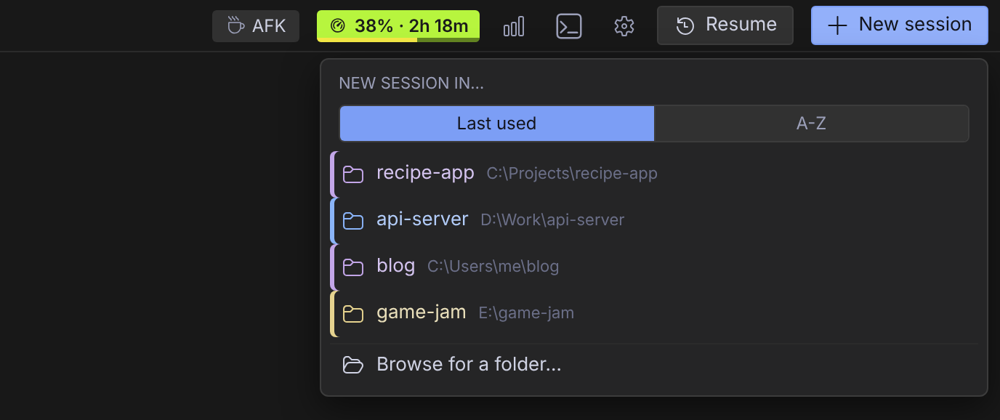
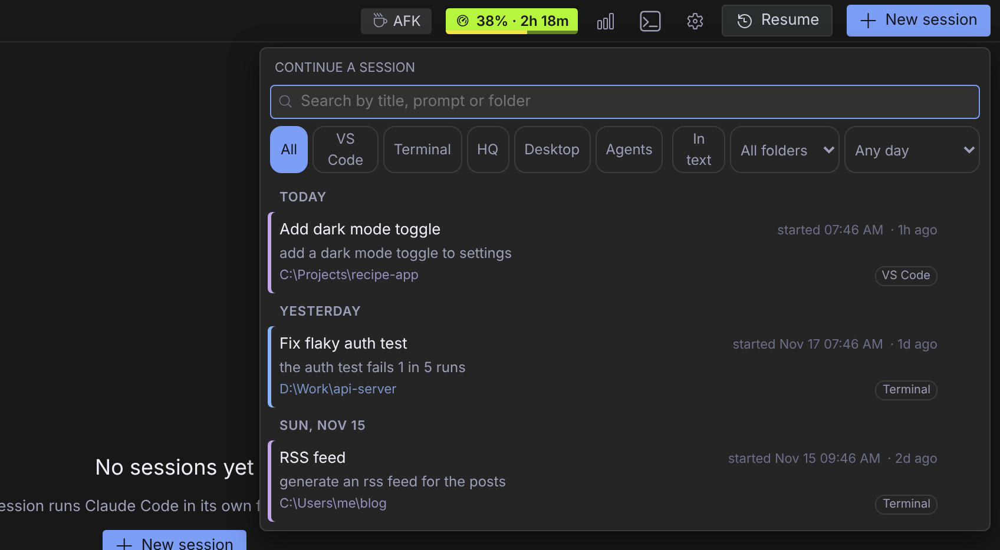
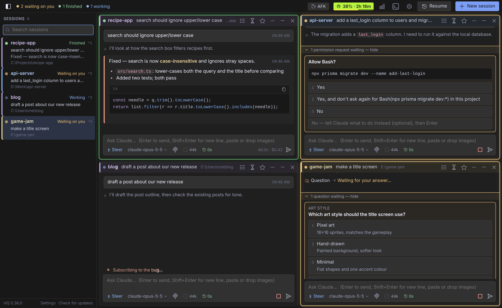
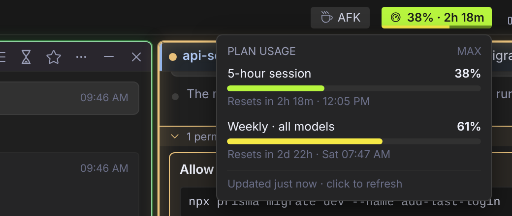
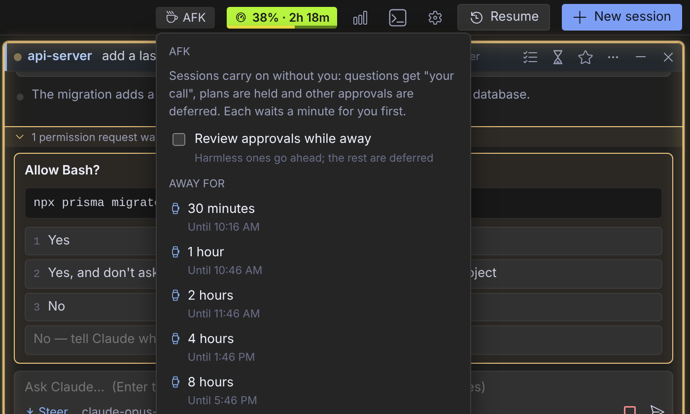
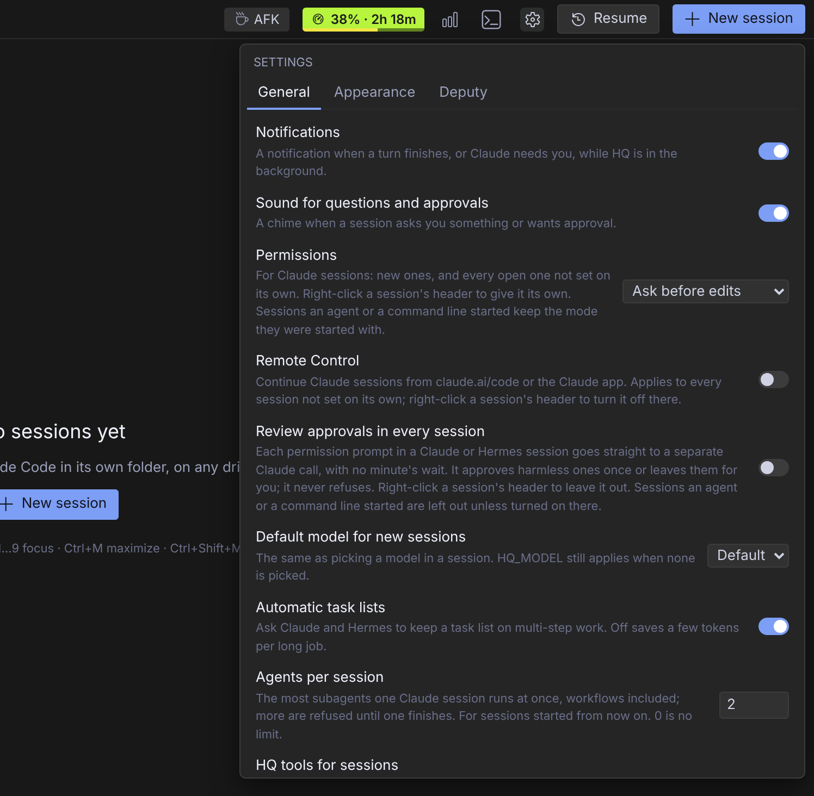

# HQ

**Run lots of Claude Code sessions side by side, in one window.**

HQ is a small desktop app for Windows and macOS. Each tile on the board is its own Claude Code
chat, working in its own folder, on any drive. You can see at a glance which sessions are
working, which have finished and which are waiting on you.



- **One board, many sessions.** Add as many as you like. The grid lays itself out.
- **Chat view, not a terminal.** Replies, diffs and permission prompts look like the VS Code
  extension.
- **Know what needs you.** Each tile glows amber when Claude needs an answer and green when it
  has finished.
- **Light.** The installer is about 1.5 MB, and an empty tile costs nothing until you send it a
  message.

---

## Contents

- [Install](#install)
- [First run](#first-run)
- [Quick start](#quick-start)
- [Everyday use](#everyday-use)
- [Keyboard shortcuts](#keyboard-shortcuts)
- [Updates](#updates)
- [Good to know](#good-to-know)
- [More documentation](#more-documentation)

---

## Install

You need a Claude account (a Pro, Max, Team or Enterprise plan, or a Console API key). HQ
installs Claude Code for you if it is missing.

### Windows

1. Go to the [latest release](https://github.com/BrydonJ/HQ/releases/latest).
2. Download **`HQ_<version>_x64-setup.exe`**.
3. Run it. No admin rights are needed.
4. Start **HQ** from the Start menu.

### macOS (10.15 or later, Apple Silicon and Intel)

1. Go to the [latest release](https://github.com/BrydonJ/HQ/releases/latest).
2. Download **`HQ_<version>_universal.dmg`** and open it.
3. Drag **HQ** into **Applications**. Run it from there, because only a copy in Applications
   updates itself.
4. The first time you open it, macOS blocks it, because the app is not signed with an Apple
   Developer ID. Do **one** of these:
   - Open **System Settings > Privacy & Security** and click **Open Anyway** next to the HQ
     message.
   - Or run this once in Terminal:

     ```bash
     xattr -dr com.apple.quarantine /Applications/HQ.app
     ```

   Updates never need this step again.

On a Mac, shortcuts use **Cmd** where this guide says **Ctrl**.

---

## First run

If Claude Code is not installed, or you are signed out, HQ offers to fix it:



1. Click **Install Claude Code**. HQ runs Anthropic's own installer in the background.
2. A small sign-in window opens your browser. Approve the sign-in there.
3. HQ notices by itself and carries on. You do not need to restart it.

HQ never sees your password or token. Claude Code stores them itself.

---

## Quick start

1. **Click New session** (or press **Ctrl+N**) and pick a folder. Recent folders are listed,
   or choose **Browse for a folder…** to pick any folder on any drive.

   

2. **Type what you want** in the box at the bottom of the tile and press **Enter**.
   **Shift+Enter** adds a new line. You can paste or drop images in too.
3. **Answer prompts when they come up.** When Claude wants to run a command or edit a file, the
   tile glows amber and shows a card:
   - **1 · Yes**: allow it once.
   - **2 · Yes, and don't ask again**: allow this kind of request from now on in this project.
   - **3 · No**: refuse. You can type what Claude should do instead.

   Press the number keys, or click.
4. **Add more sessions** the same way. Each one works on its own while you watch the others.

### Reading the board

| What you see | What it means |
| --- | --- |
| A light sweeping across the project name, and a spinner above the input box | Claude is working |
| Pulsing **amber** glow | Claude is waiting on you: a permission, a question or a plan |
| **Green** glow | Finished while you were looking at something else |
| Spinner badge with a number | Background tasks Claude started are still running |

The top bar adds it up, for example *2 waiting on you · 1 finished · 1 working*. When HQ is in
the background, you also get a desktop notification and the taskbar button flashes.

---

## Everyday use

### Continue a session from VS Code or the terminal

Click **Resume** (or press **Ctrl+O**) to pick up a Claude Code session started anywhere else:
VS Code, a terminal or the desktop app. Search by title, prompt or folder, or turn on
**In text** to search inside the conversations.



- **Click a session** to open it with its history.
- **Fork** (the branch icon) continues in a copy and leaves the original alone.
- A session marked **Active** was used in the last few minutes. Close it in VS Code first, so
  two windows do not write to it at once.

### The sessions list

Press **Ctrl+B** (or the button at the top left) for a list of every session with its status,
first prompt and latest reply. Type to search, and click a session to jump to it.



### Inside a tile

- **Header buttons:** a few are shown by default (progress, detail level, waiting mode,
  collapse, close). The **…** menu holds the rest: open the folder in VS Code, a terminal or
  Explorer/Finder, a handoff note for a fresh session, and more. Settings lets you choose which
  buttons stay in the header. Detail level and waiting mode were pinned once on existing
  installs; unpin them and they stay unpinned.
- **Rename** a session by clicking its name, or with **F2**. VS Code sees the new name too.
- **Detail level** chooses how much you see: everything, replies without tool calls (the
  default), or replies only.
- **The model button** in the input bar picks the model and effort level.
- **The small ring** in the input bar shows how full the context is. Click it to compact the
  conversation.
- **Steer or Queue:** a message sent while Claude works either reaches the running turn
  (**Steer**) or waits until it finishes (**Queue**).
- **Esc** stops the session. **Ctrl+M** (or double-clicking the header) maximizes it.
  **Ctrl+Shift+M** collapses it into a strip under the board.
- **Permissions:** every new session starts in Claude's **auto** mode. Hermes has no auto
  mode, so new Hermes sessions start in **Edit automatically** (edits in the folder go ahead;
  commands follow Hermes' own approval settings). To change one session, open the **…** menu in
  its header (or right-click the header) and use the Permissions section.
- **Right-click a header** for that session's own settings: permission mode and Remote Control.
- **Waiting mode:** the header button hides the chat behind a waiting view (the task list and a
  loader) while the session works, and **Show chat** brings it back. Turn it on while
  a session is idle but still has open tasks (or background tasks) and the waiting view shows
  straight away. When a turn has run 45 seconds and you have not clicked or typed in that
  session, a slim bar above the input box offers waiting mode (**Yes** or **No**), once per
  turn. It goes away when the turn ends. Turn the offer off in Settings > General
  (**Offer waiting mode**); three **No**s in a row turn it off by themselves.
- **Slash commands:** type `/` to list Claude's commands, skills and your custom commands.
  `/1s` (or `/one-sentence`) switches on one-sentence replies, and `/1s off` ends it. It works
  in Claude and Hermes sessions.
- **Permission cards:** a lone card fits the space under the chat. Its command or diff is the
  one scroll area, long commands wrap, and the choices stay in view. The expand button in the
  card's title gives the card the whole tile.
- **The tray:** docked sessions sit in a tray inside their starter, above its composer (or as a
  card in its waiting view), one row each with its state. A question or permission one asks
  opens in its row, to answer there without opening it; meanwhile the starter's border turns
  amber. Click a row to open that session in the grid; **Open all** and **Dock all** move them
  together. When the starter is collapsed or closed, they go back to the dock. A collapsed
  session that another open session started sits in that session's tray instead of the dock.
- **Orchestrator columns:** the pin button in the tile header pins a session as an
  orchestrator. Each pinned session gets a full-height column, side by side, and the other
  sessions stack in a strip on the right (drag the gaps to resize). Pinned columns take the
  place of the spotlight while any is open. Above each column, a bar shows how many of the
  sessions it started are done, and turns amber while one of them waits on you; the × there
  unpins it. Pinning is your choice and is kept across restarts: starting sessions never pins
  one.

### Plan usage

The coloured pill in the top bar shows how much of your plan's 5-hour limit you have used, and
when it resets. It goes from green to red as you near the limit. Hover or click it for the
weekly limit as well.



If a session hits the limit, it carries on by itself once usage is back. The graph button next
to it (**Ctrl+U**) shows where your tokens went, per day, session, folder or model. Hermes
sessions are included, tagged Hermes.

### Going AFK

Stepping away? Click **AFK** in the top bar and choose how long. Sessions then carry on with
whatever they can do without you, instead of stopping at the first question:



- Questions are answered with Claude's own recommended option.
- Plans are held for you.
- Other permission requests are put off until later, and the session works on the rest.
- Every card waits a minute first, in case you are still there.
- Tick **Make a deputy to answer approvals and questions while I'm away** to have a session
  answer for you instead. If no deputy exists, HQ starts a new Claude session named Deputy in
  an empty folder of its own (never a project folder), set to Never AFK. It stops being the
  deputy when no AFK that asked for it is left, and the session stays open. A deputy you
  picked yourself is kept, and AFK never ends it.

When you are back, each session shows a **While you were away** card listing what it did and
what it put off.

### Settings

Click the gear (or press **Ctrl+,**) for the theme, notifications, the default
model, Remote Control (continue sessions from claude.ai or the Claude phone app) and
more.



---

## Keyboard shortcuts

| Keys | Action |
| --- | --- |
| **Ctrl+N** | New session |
| **Ctrl+O** | Resume a session from VS Code or the terminal |
| **Ctrl+B** | Show or hide the sessions list |
| **Ctrl+1 … 9** | Focus a tile |
| **Ctrl+M** | Maximize the focused tile |
| **Ctrl+Shift+M** | Collapse or expand the focused tile |
| **Ctrl+W** | Close the focused tile |
| **Ctrl+U** | Token usage |
| **Ctrl+,** | Settings |
| **F2** | Rename the focused session |
| **Esc** | Stop the focused session |
| **1 … 9** | Answer the top permission card or question |
| **Enter** / **Shift+Enter** | Send / new line |

On a Mac, use **Cmd** instead of **Ctrl**.

---

## Updates

HQ keeps itself up to date. It downloads new versions in the background and installs one when
you have been idle for a couple of minutes and nothing would be lost. It then reopens with the
same board, and Claude sessions keep running through the restart.

To update straight away, click the **Update** button that appears in the top bar.

---

## Good to know

- **Closing HQ** while sessions are working (a turn, a question or permission, background
  tasks) asks first, and lists them. Esc or **Keep HQ open** keeps it. If the page does not
  answer, a second close a few seconds later goes through.
- **Sessions agents start:** the setting of that name in Settings opens them docked (the
  default), full size or small (half width, smaller text).
- **Your board is saved.** Close HQ and everything comes back next time: tiles, history and
  unsent drafts. A reopened session uses no memory until you send it a message.
- **Only open folders you trust.** HQ runs Claude without Claude's "do you trust this folder?"
  question.
- **Costs:** sessions use your Claude plan like the CLI does. Cost figures in HQ are estimates
  at API prices, not what your plan bills.
- **Not supported yet:** `@` file mentions. Commands that need Claude's interactive terminal
  either print a short answer or are not offered. Use the buttons in the tile for the model,
  effort and MCP servers.
- **Uninstalling on Windows:** if you turned on **Open in HQ in Explorer**, turn it off in
  Settings first, because the uninstaller leaves that menu behind.

---

## More documentation

- **[Feature reference](docs/REFERENCE.md):** everything HQ does, in detail. It covers API
  credits, Remote Control, the deputy, cloud and Hermes sessions, and HQ's MCP tools
  that let sessions start and talk to each other.
- **[Building and releasing](docs/DEVELOPMENT.md):** for people working on HQ itself. It covers
  building from source, profiles, tests, releases and the code layout.
